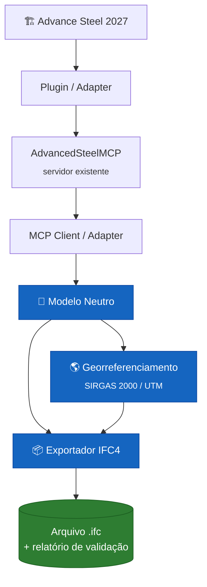

# 🏗️ Plugin Advance Steel — Brunno

**Do modelo estrutural ao IFC4 georreferenciado, sem perder nenhuma propriedade.**

Plugin independente para **Autodesk Advance Steel 2027** que extrai o modelo via [AdvancedSteelMCP](https://github.com/Shame625/AdvancedSteelMCP) e gera um **IFC4 próprio**, posicionado em **SIRGAS 2000 / UTM**.

[Visão geral](#-visão-geral) •
[Arquitetura](#-arquitetura) •
[Roadmap](#-roadmap) •
[Documentação](#-documentação)

---

## ✨ Visão geral

Exportar um modelo de estrutura metálica para IFC costuma significar escolher entre duas perdas: **dados** (propriedades que somem no caminho) ou **posição** (o modelo chega na origem e precisa ser reposicionado à mão). Este projeto existe para eliminar as duas.

| | Recurso | O que significa |
|:-:|---|---|
| 🔌 | **Integração MCP** | Lê o modelo do Advance Steel através do AdvancedSteelMCP, sem modificar o repositório original |
| 🧩 | **Modelo neutro** | Camada intermediária independente do CAD, do protocolo e da biblioteca IFC — testável sem abrir o Advance Steel |
| 🗂️ | **Preservação integral** | Todas as propriedades acessíveis — gerais, herdadas, específicas e User Attributes — sem whitelist fechada |
| 🌎 | **Georreferenciamento real** | `IfcProjectedCRS` + `IfcMapConversion` a partir de um ponto de controle e do ângulo com o Norte |
| 📦 | **Exportador IFC4 próprio** | Não depende do exportador nativo; cada exportação gera um relatório de cobertura e limitações |

## 🧭 Arquitetura

**Princípio central:** a API do Advance Steel não contamina o núcleo. O exportador consome **apenas** o modelo neutro, nunca o JSON bruto do MCP. Detalhes em [ARCHITECTURE.md](ARCHITECTURE.md).

### Mapeamento IFC4 previsto

| Advance Steel | IFC4 |
|---|---|
| Vigas / perfis | `IfcBeam` |
| Chapas | `IfcPlate` |
| Parafusos e chumbadores | `IfcMechanicalFastener` |
| Soldas | `IfcWeld` |
| Peças especiais | tipo específico ou `IfcBuildingElementProxy` |

Propriedades sem equivalente IFC padrão vão para **Property Sets customizados**, preservando nome técnico, valor, tipo, unidade e proveniência. Veja [IFC4-MAPPING.md](docs/IFC4-MAPPING.md).

## 🗺️ Roadmap

| Etapa | Descrição | Status |
|:-:|---|:-:|
| 1 | Fundação do projeto e especificações | ✅ Concluída |
| 2 | Integração com Advance Steel + MCP | 🟡 Revisão estática feita, validação local pendente |
| 3 | Modelo neutro e preservação integral | 🟡 Contrato definido, implementação pendente |
| 4 | Georreferenciamento SIRGAS 2000 / UTM | ⚪ Planejada |
| 5 | Exportador IFC4 | ⚪ Planejada |

Lista completa de tarefas e critérios de saída em [docs/ROADMAP.md](docs/ROADMAP.md).

> [!NOTE]
> O projeto está em fase de especificação. Ainda não há código executável: nada é dado como "pronto" antes de ser validado em um modelo real do Advance Steel 2027.

## 📚 Documentação

| Documento | Conteúdo |
|---|---|
| [ARCHITECTURE.md](ARCHITECTURE.md) | Módulos, fluxo de dados e responsabilidades |
| [MCP-INTEGRATION.md](MCP-INTEGRATION.md) | Diretrizes de integração com o AdvancedSteelMCP |
| [MCP-REVIEW.md](MCP-REVIEW.md) | Auditoria do código-fonte do MCP |
| [LOCAL-VALIDATION.md](LOCAL-VALIDATION.md) | Roteiro de testes somente leitura no Advance Steel |
| [docs/NEUTRAL-MODEL.md](docs/NEUTRAL-MODEL.md) | Contrato do modelo neutro |
| [docs/PROPERTY-PRESERVATION.md](docs/PROPERTY-PRESERVATION.md) | Política de preservação integral de propriedades |
| [docs/IFC4-MAPPING.md](docs/IFC4-MAPPING.md) | Matriz de mapeamento para IFC4 |
| [IFC-EXPORTER.md](IFC-EXPORTER.md) | Especificação do exportador IFC |
| [GEOREFERENCING.md](GEOREFERENCING.md) | Especificação do georreferenciamento |
| [decisions/](decisions/) | Registros de decisões de arquitetura (ADRs) |

## 🙏 Créditos

- [AdvancedSteelMCP](https://github.com/Shame625/AdvancedSteelMCP), usado como infraestrutura externa.
- Autodesk Advance Steel é marca registrada da Autodesk, Inc. Este é um projeto independente, sem afiliação com a Autodesk.

---

Feito com ☕ e aço por **Brunno**

